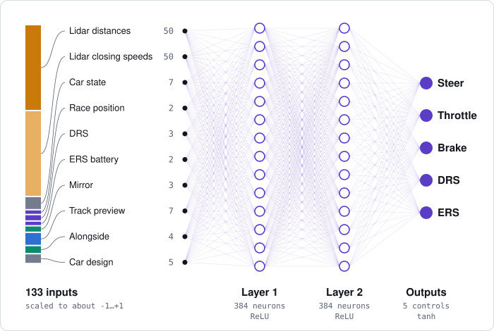
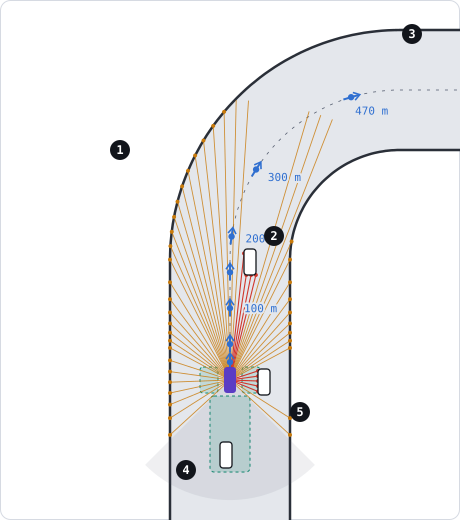
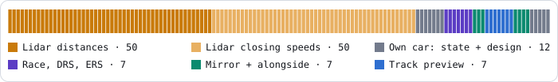

# F1 simulator

A multi-car Formula 1 style racing simulator built on the [F1TENTH gym](https://github.com/duckpop/f1tenth_gym), with 23 real circuits scaled up to F1 size. Every car is driven by a small neural network that learned to race by reinforcement learning (TD3). Twenty times a second it reads 133 numbers about the car and its surroundings and answers with five controls: steer, throttle, brake, DRS and ERS. Nobody programmed how to drive: it raced millions of times and kept what scored well.

| Inputs | Hidden layers | Controls | Decisions | Weights |
|---|---|---|---|---|
| 133 | 2 × 384 | 5 | 20 per second | 201,221 |

**Contents:** [Quick start](#quick-start) · [How the AI driver works](#how-the-ai-driver-works) · [How it learns](#how-it-learns) · [Physics and race rules](#physics-and-race-rules) · [Using the code](#using-the-code) · [Configuration](#configuration) · [What's where](#whats-where)

## The drivers

Three driver personalities share the same network shape and differ only in their rewards. Each one's best checkpoint is included in `saved_models/`.

| Driver | Style | Best eval |
|---|---|---|
| `middle` | The baseline racer. Passes when the risk is small | 8,191 m mean distance in 22-car races |
| `aggressive` | Bold in traffic, contact is cheaper | 17.80 race points per car against middle |
| `defensive` | Very hard to pass, avoids contact | 4.34 race points per car against middle and aggressive |

Cars also have designs (engine, battery, chassis, brakes, wing, levels 1 to 5, 17 points to spend), and a separate designer bot can learn which design to give each driver over a season.

## Quick start

Needs Python 3.11 or newer and [uv](https://docs.astral.sh/uv/). Training needs an NVIDIA GPU; watching and comparing run on the CPU.

```bash
git clone --recurse-submodules git@github.com:duckpop/f1-simulator.git
cd f1-simulator
uv venv
uv pip install -r requirements.txt
```

The tracks (`maps/f1tenth_racetracks`) and the gym (`f1tenth_gym`) are git submodules. If you cloned without `--recurse-submodules`, run `git submodule update --init`.

Watch the three drivers race at Monza:

```bash
uv run watch.py --profiles middle,aggressive,defensive --cars 22 --map Monza --episodes 3 --seconds 300
```

## How the AI driver works

### One decision every 50 milliseconds

1. **Sense.** Lidar, mirror, track preview and the car's own state become 133 numbers.
2. **Think.** The numbers flow through two layers of 384 neurons.
3. **Act.** Out come steer, throttle, brake, DRS and ERS, and the physics moves the car.
4. **Learn** (training only). A reward says how good that was, and two critic networks turn it into a lesson.

### The brain



Each neuron adds up its inputs, each multiplied by a learned weight, and passes the total on if it is above zero (ReLU). The last layer squashes each output into −1…+1 (tanh). That is the whole driver: a fully connected network of 133 → 384 → 384 → 5.

- **201,221 weights:** 133×384 + 384 for layer 1, 384×384 + 384 for layer 2, 384×5 + 5 for the outputs.
- **Why two layers of 384:** two hidden layers is the standard shape for TD3 when the inputs are already meaningful numbers rather than camera pixels. The width is a speed choice: 512 neurons halved the training speed on the laptop's RTX 3050 Ti.
- **Two critics, training only:** each critic has the same shape with 138 inputs (the 133 observations plus the 5 controls) and one output, a prediction of the reward that will follow. The driver is pushed toward controls the critics rate higher, and the lower of the two predictions is trusted so it does not get overconfident.

The network is defined in [`racer/agent.py`](racer/agent.py) (`Actor`, `TwinCritic`). Races outside training run it with plain numpy ([`racer/policy.py`](racer/policy.py)), so watching and comparing need no GPU.

### What the car sees



Not to scale: the car is about 5 m long and the lidar reaches 390 m. The beams are drawn at their real angles and ray-cast against the walls and three other cars.

1. **Lidar, 50 beams.** The simulator casts 108 beams over 270°, reaching 390 m (about 1.35 × the stopping distance of the fastest car). The network gets 50 of them: every beam within ±25° of straight ahead, every 2nd out to ±60°, every 4th out to ±132.5°. Each beam gives a distance and a closing speed.
2. **Cars in the beams.** Beams that hit another car (red) shrink fast when that car brakes. The closing speed is how the driver notices.
3. **Track preview.** The direction of the track at 25, 50, 100, 150, 200, 300 and 470 m ahead, relative to the car. It knows a corner is coming even when cars block the lidar.
4. **Mirror.** The nearest car behind within 60 m and 10 m to either side: distance, closing speed and side. It covers the lidar's 90° blind spot behind (shaded).
5. **Alongside.** Left and right: the gap to a car overlapping it, within 6 m, and how fast that car moves sideways.

The car does not know the race clock, the lap number, or which driver is in the cars around it. The sensors are in [`racer/sensors.py`](racer/sensors.py).

### All 133 inputs



| Index | Group | Count | What each number is | Scaled as |
|---|---|---|---|---|
| 0–49 | Lidar distances | 50 | Distance to the first wall or car along each beam | √(distance ÷ 390 m) |
| 50–99 | Lidar closing speeds | 50 | How fast each beam's distance is shrinking | ÷ top speed, clipped to ±2 |
| 100–106 | Car state | 7 | Speed, steering, turning rate, sliding, its last three controls | see below |
| 107–108 | Race | 2 | Position in the race, number of other cars | −1…+1, ÷ 22 |
| 109–111 | DRS | 3 | Available, open, metres of zone left | 0/1, 0/1, ÷ 500 m |
| 112–113 | ERS | 2 | Battery level, deploying or not | 0…1, 0/1 |
| 114–116 | Mirror | 3 | Nearest car behind: distance, closing speed, side | ÷ 60 m, ÷ 20 m/s, ÷ 5 m |
| 117–123 | Track preview | 7 | Track direction 25–470 m ahead, relative to the car | angle ÷ π |
| 124–127 | Alongside | 4 | Left and right: gap and sideways speed of a car beside it | ÷ 6 m, ÷ 10 m/s |
| 128–132 | Car design | 5 | Its own engine, battery, chassis, brakes and wing levels | (level − 3) ÷ 2 |

### The car's own numbers

**State (7)**

| # | Input | Scaled as |
|---|---|---|
| 1 | Speed | ÷ 86.1 m/s (310 km/h, the stock top speed) |
| 2 | Steering angle | ÷ 0.6 rad |
| 3 | Turning rate (yaw rate) | ÷ 2 rad/s, clipped to ±2 |
| 4 | Sideways slide (slip angle) | radians, clipped to ±1 |
| 5 | Its last steering output | −1…+1 |
| 6 | Its last throttle output | −1…+1 |
| 7 | Its last brake output | −1…+1 |

**Race, DRS and ERS (7)**

| # | Input | Scaled as |
|---|---|---|
| 8 | Race position: +1 leading, −1 last | (cars behind − cars ahead) ÷ (cars − 1) |
| 9 | Other cars in the race | ÷ 22 |
| 10 | DRS available now | 0 or 1 |
| 11 | DRS open | 0 or 1 |
| 12 | DRS zone left | ÷ 500 m |
| 13 | Battery level | 0…1 |
| 14 | ERS deploying | 0 or 1 |

**Car design (5).** Level 1 → −1, stock 3 → 0, level 5 → +1. Each level moves a quantity by 5%, and no quantity moves more than 15% overall.

| # | Category | A higher level gives | At the cost of |
|---|---|---|---|
| 15 | Engine | More acceleration and top speed | Less braking |
| 16 | Battery | Bigger ERS battery, faster recharge | Less steering |
| 17 | Chassis | More cornering grip | Less acceleration and top speed |
| 18 | Brakes | Stronger braking | More drag, lower top speed |
| 19 | Wing | Less drag, higher top speed | Less braking, ERS drains faster |

In training, 80% of the cars get a random legal design and 20% the stock car (3-3-3-3-3). Evals, `watch.py` and `compare.py` use the stock car unless you pass `--designs`.

### The five controls

| Output | Range | What it does |
|---|---|---|
| Steer | −1…+1 | A share of the steering the tyres can take at this speed, so full lock does not spin the car by itself |
| Throttle | above 0 counts | Engine power; letting off adds engine braking |
| Brake | above 0 counts | Braking force; off the throttle, brakes and engine braking together reach 120% |
| DRS | above 0 opens | Opens the rear wing in a DRS zone when armed: +6% top speed. Stays open until the driver brakes or the zone ends |
| ERS | above 0 deploys | +25% engine power from a 10-second battery that recharges under braking |

## How it learns

Training uses TD3, a reinforcement learning method for continuous controls ([`train.py`](train.py), [`racer/agent.py`](racer/agent.py)).

- **Racing:** six worker processes race 22-car fields on all 23 tracks, switching track every ~100,000 steps of data. Training races are 150 s long and start from the grid. The trained brain drives a third of the cars when it has opponents, all of them when it doesn't. Each of its cars gets its own exploration noise per race, so some drive cleanly and some experiment.
- **Reward:** each step pays for distance covered (+1 per step at top speed), and races add passes, places gained, fast sectors and closing on the car ahead. Crashes, being passed, near misses and twitchy steering cost points. The critics learn to predict the reward of roughly the next 5 seconds (discount 0.99, 3-step returns).
- **Memory:** every step goes into a replay memory of up to 18.4 million moments (6.4 million on the GPU, the rest in RAM, leaving 2 GB of RAM free). The GPU trains on random batches of 256, so the driver keeps learning from old races too, at about 3,700 steps per second on a laptop RTX 3050 Ti.
- **Picking the best:** every 10,000 updates, the current driver races 6 tracks (Spielberg, Monza, Silverstone, Spa, Zandvoort, Catalunya) without noise. Without opponents the score is mean distance; with opponents it is race points per car, scored by the profile's rules. A new best is saved as `td3_best.pt`.

**Three personalities, one brain shape** ([`configs/profiles/`](configs/profiles)):

| Driver | Pass a car | Get passed | Hit a car | Hit a wall | Other differences |
|---|---|---|---|---|---|
| Middle | +20 | −20 | −70 | −70 | The defaults in `[rewards]` |
| Aggressive | +40 | −40 | −45 | −70 | No penalty for near misses with cars or for twitchy steering, no fastest-sector or record bonus |
| Defensive | +20 | −90 | −160 | −160 | Each race point held is worth 8 instead of 5; evals take 4 points off per time passed |

**Head to head over 300 races** (22 cars, seats swapped): the aggressive driver beat the middle driver by 11.3 F1 points per race (55.3 to 44.0, 95% confidence 8.0 to 14.5), with 171 wins to 129, while hitting walls twice as often.

## Physics and race rules

- **Car:** the F1TENTH kinematic single-track model at F1 scale. Stock top speed 86.1 m/s (310 km/h); grip from 1.8 g up to 5 g with downforce. Braking and cornering share the tyre's grip (traction circle).
- **Engine braking:** off the throttle the car slows by half its full braking, and brakes plus engine braking reach 120%.
- **Slipstream:** within 120 m behind another car, up to +10% top speed and extra pull.
- **DRS:** zones on straights of at least 200 m, ending about 200 m before the next corner. A car is armed when it passes the detection point (the exit of the final corner) less than 1 s behind the car ahead, backmarkers included, from 30 s into the race.
- **ERS:** a 10-second battery, 85% charged at the start. It recharges under braking, 1.5× faster for a lap after passing the detection point within 1 s of the car ahead.
- **Starts:** 22 cars on a two-column grid, 12 m between slots and 8 m between columns, with a 2-second full-throttle launch.
- **Passes and crashes:** a pass counts once held for 1 s with both cars racing. Hitting a wall or a car ends that car's race, and so does making no progress for 6 s.
- **Tracks:** the 23 F1TENTH circuits scaled 12× (about 26 m wide, laps of 3–6.5 km).

## Using the code

Every script has `--help`. Checkpoints are named by profile and tag: `best`, `latest`, an update count, or a backup name, e.g. `aggressive:latest` or `defensive:best_front12` for `saved_models/defensive/td3_best_front12.pt`.

### Watch a race: `watch.py`

```bash
uv run watch.py --profiles middle,aggressive,defensive --cars 22 --map Monza
uv run watch.py --profiles aggressive,aggressive:latest --cars 10 --map random --episodes 5
uv run watch.py --cars 22 --designs --map Spa
uv run watch.py --list-maps
```

| Option | Meaning |
|---|---|
| `--profiles` | Drivers given to the cars in turn; `PROFILE:TAG` picks another checkpoint |
| `--cars` | Cars on the grid |
| `--map` | Track name, or `random` |
| `--episodes` | Races in a row (the grid is shuffled each time) |
| `--seconds` | Race length (default 150 s) |
| `--speed` | Playback speed: 1 = real time, 3 = 3× (default), 0 = as fast as possible |
| `--designs` | Give car pairs the teams' designs from `configs/designs.toml` |
| `--random-spawn` | Spread the cars around the track instead of the grid |
| `--window` | `max` (default) or a size like `1920x1080` |

In the window: the camera follows the race leader. Right-click jumps to the next car, drag moves the view, middle-click shows the whole track, and `L` follows the leader again. The left panel shows live standings, and the bottom-right panel shows the followed car's steering, throttle and brake, its DRS and ERS lights and battery.

### Compare two drivers: `compare.py`

```bash
uv run compare.py --a aggressive --b middle --races 300 --workers 8
uv run compare.py --a defensive --b defensive:best_front12 --races 100 --maps Monza,Spa
uv run compare.py --leaderboard
```

Races are run in pairs with the seats swapped, half the grid each. The table shows F1 points, wins, podiums, finishes, crashes and passes, and the verdict gives the points difference with a 95% confidence interval. `--leaderboard` prints every profile's lap records per track. Each worker needs about 0.6 GB of RAM.

### Train a driver: `train.py`

```bash
# middle from scratch, every car driven by itself
uv run train.py --profile middle --cars 22 --steps 150000000
# aggressive from middle's driver, racing middle
uv run train.py --profile aggressive --resume middle/best --opponents middle --opponent-speed 1.0 --lr 1e-4 --cars 22 --steps 70000000
# continue defensive from its last save
uv run train.py --profile defensive --resume latest --opponents middle,aggressive --opponent-speed 1.0 --lr 1e-4 --cars 22 --steps 100000000
```

| Option | Meaning |
|---|---|
| `--profile` | Which driver to train |
| `--steps` | Stop after this many collected steps |
| `--cars` | Cars per race, or a list like `6,12,18,22` that workers draw from |
| `--resume` | `best`, `latest`, an update count, or `PROFILE/TAG` to start from another driver |
| `--opponents` | Frozen opponents, e.g. `middle,aggressive` (list one twice for twice the cars) |
| `--opponent-speed` | Opponents' top speed in training as a share (evals race them at full speed) |
| `--self-share` | The trained driver's share of each grid (default a third) |
| `--front-slots` | Start the trained driver's cars in the first N grid slots |
| `--lr` | Learning rate (1e-4 to fine-tune a trained driver) |
| `--best-by` | What picks `td3_best.pt`: `distance`, `points`, or `auto` |
| `--workers` | Rollout processes (default 6) |

A live dashboard shows training stats, eval rounds, the best so far, RAM and lap records. Ctrl+C stops the run and saves `td3_latest.pt`. A resumed run first refills its memory with 1 million steps, then trains only the critics for 150,000 updates before the driver changes. A stored best only counts when the run's settings match; after a rules or scoring change the old best is set aside and the run starts its own.

Each driver's folder in `saved_models/` holds `td3_best.pt`, `td3_latest.pt`, the last 5 periodic saves, `metrics.csv` (training stats every minute), `evals.csv` (every eval round), `best_meta.json` and `lap_records.json`. Only the best checkpoint and the two JSON files are in git.

### Check on a run: `status.sh` and `report.py`

```bash
./status.sh defensive
uv run --with matplotlib report.py --profile middle
```

`status.sh` prints whether training is running, GPU and RAM, the best eval, and per-30-minute tables of eval rounds and training stats (including how often the driver is passed). `report.py` plots a profile's training progress to `saved_models/<profile>/progress.png`.

### Seasons and the car designer: `train_designer.py`, `season.py`

```bash
uv run train_designer.py --decisions 200000
uv run season.py --seed 1 --save-designs
```

A season has 11 teams of 2 cars racing 23 races, one per track. Before each race the designer may make 2 point moves on each team's car. `train_designer.py` trains it as a double DQN over many seasons; `season.py` races one season with it, and `--save-designs` writes the final cars to `configs/designs.toml` for `--designs`. No designer checkpoint is included yet, so train one before running `season.py`.

### Regenerate the diagrams

```bash
uv run docs/make_diagrams.py
```

The three images in `docs/` are drawn from the real settings (beam angles, preview distances, input layout).

### Long training runs

- Start long runs inside `screen` (e.g. `screen -S defensive uv run train.py ...`) so closing a terminal does not kill them; `screen -r defensive` brings the dashboard back.
- Limit a run with `--steps`. Stop it with Ctrl+C, which saves `td3_latest.pt`.
- A laptop that goes to sleep or overheats stalls training. If the step rate suddenly drops to about a third, check `nvidia-smi` for a throttled GPU.

## Configuration

Everything tunable is in [`configs/settings.toml`](configs/settings.toml), with comments on each value.

| Section | Controls |
|---|---|
| `[car]`, `[grip]`, `[engine]`, `[tow]`, `[drs]`, `[ers]` | The car and its physics |
| `[sim]`, `[sensors]`, `[spawn]`, `[variation]` | Tracks, timing, sensors, starts and training randomness |
| `[race]`, `[rewards]`, `[eval_bonus]` | Pass rules, rewards and eval scoring (profiles override these) |
| `[td3]`, `[workers]`, `[eval]`, `[run]` | Learning, rollout workers, evals and checkpoints |
| `[design]`, `[season]`, `[designer]` | Car designs, seasons and the designer bot |
| `[watch]`, `[colors]` | Defaults for `watch.py` and each driver's colour |

The three personalities are in [`configs/profiles/`](configs/profiles): each file overrides any `[rewards]` or `[eval_bonus]` value. The full specification is in [`project.md`](project.md) and [`project_v2.md`](project_v2.md).

## What's where

| Path | Contents |
|---|---|
| `racer/` | The simulator: race environment ([`env.py`](racer/env.py)), physics, sensors, track handling, the TD3 agent, rollout workers, scoring, seasons and designs |
| `configs/` | Settings, the three driver profiles, team designs |
| `saved_models/<driver>/` | Each driver's best checkpoint, its eval record and lap records |
| `train.py`, `watch.py`, `compare.py`, `season.py`, `train_designer.py`, `report.py`, `status.sh` | The command-line tools |
| `docs/` | The README's diagrams and the script that draws them |
| `project.md`, `project_v2.md` | The full specification |
| `f1tenth_gym/` | Fork of the F1TENTH gym (submodule) |
| `maps/f1tenth_racetracks/` | The F1TENTH race tracks (submodule) |
